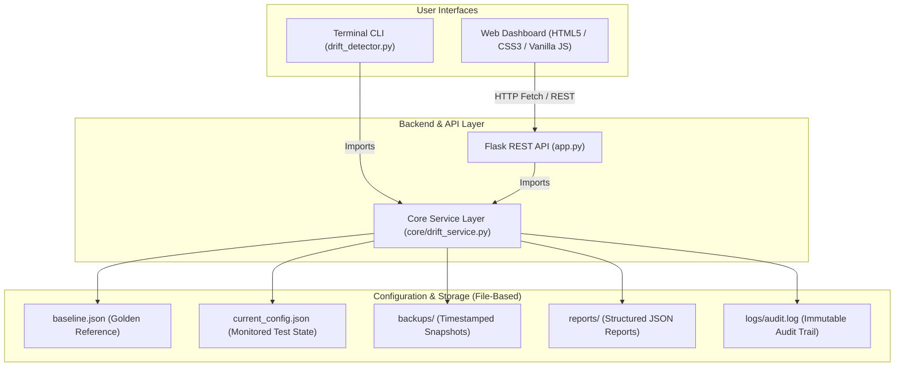

# Linux Infrastructure Drift Detection & Auto Repair System

A configuration monitoring, drift detection, and automated remediation platform designed for Linux infrastructure environments. The system features a unified Python core service powering both an interactive terminal CLI and a web dashboard.

---

## 1. System Architecture

The architecture uses a single source of truth (`core.drift_service`) so that neither the terminal CLI nor the Flask web dashboard duplicates business logic.



---

## 2. Project Directory Structure

```text
Linux Micro Project/
├── app.py                      # Flask application and REST API routes
├── drift_detector.py           # Interactive terminal CLI application
├── linux_repair.py             # Standalone repair utility with backup logic
├── report_generator.py         # JSON drift report generator utility
├── baseline.json               # Golden approved reference configuration
├── current_config.json         # Active monitored test configuration
├── requirements.txt            # Pinned Python package dependencies
├── .gitignore                  # Git exclusion rules
│
├── core/
│   ├── __init__.py
│   └── drift_service.py        # Centralized business logic (single source of truth)
│
├── static/
│   ├── css/
│   │   └── style.css           # Responsive stylesheet (dark sidebar / light main canvas)
│   └── js/
│       └── app.js              # Client-side controller (Fetch API, Canvas chart, Modals)
│
├── templates/
│   └── index.html              # Dashboard interface with 8 navigation sections
│
├── backups/                    # Timestamped configuration backup archives
├── reports/                    # Historical JSON drift detection reports
├── logs/
│   └── audit.log               # Timestamped audit log trail
│
└── tests/
    ├── __init__.py
    ├── test_project.py         # Baseline & configuration integrity unit tests
    ├── test_backup.py          # Backup preservation & restore unit tests
    ├── test_drift_service.py   # Comprehensive service layer tests
    └── test_api.py             # Flask REST API integration tests
```

---

## 3. Technology Stack & Dependencies

- **Language / Runtime**: Python 3.12+ / Python 3.14
- **Backend Framework**: Flask 3.0.3, Werkzeug 3.1.8
- **Frontend**: Semantic HTML5, CSS3 Grid/Flexbox, Vanilla ES6+ JavaScript
- **Visualization**: Self-contained offline HTML5 Canvas doughnut chart
- **Storage**: JSON-based file storage, atomic file writes (`os.replace`)
- **Testing**: Python standard library `unittest`

### Installation

```bash
# 1. Clone or open the project directory
cd "Linux Micro Project"

# 2. (Optional) Create and activate a virtual environment
python3 -m venv venv
source venv/bin/activate       # On Linux/macOS
# or: .\venv\Scripts\activate  # On Windows

# 3. Install pinned dependencies
pip install -r requirements.txt
```

---

## 4. How to Run the Application

### Option A: Launch the Web Dashboard
```bash
python app.py
```
Open your browser and navigate to:
**`http://127.0.0.1:5000`**

### Option B: Run the Interactive Terminal CLI
```bash
python drift_detector.py
```

*Note: Both interfaces share the same underlying configuration files. Any drift simulation or repair performed in the CLI will immediately reflect in the web dashboard upon refresh, and vice versa.*

---

## 5. Running the Automated Test Suite

To run all 32 unit and API integration tests:

```bash
python3 -m unittest discover -s tests -v
```

### Test Suite Breakdown:
- **`tests/test_project.py`** (5 tests): Baseline validity, compliant state, single/multiple drift detection, and malformed JSON rejection.
- **`tests/test_backup.py`** (2 tests): Backup creation integrity and configuration restoration.
- **`tests/test_drift_service.py`** (11 tests): Atomic file writes, schema validation, drift comparison, simulation presets, pre-repair backup generation, and post-repair verification.
- **`tests/test_api.py`** (14 tests): Health check, dashboard statistics, configuration comparison, drift scan triggering, custom drift validation, confirmation requirements, traversal prevention, and backup restore workflows.

---

## 6. Monitored Configuration Parameters

The system monitors 6 security-critical parameters:

| Parameter Key | Golden Expected Value | Description / Purpose |
| :--- | :---: | :--- |
| `ssh_root_login` | `"no"` | Disallow direct remote root login via SSH. |
| `ssh_password_authentication` | `"no"` | Enforce SSH key-based authentication; disable passwords. |
| `firewall_enabled` | `true` | Ensure host firewall daemon is active. |
| `auto_updates_enabled` | `true` | Ensure automatic security patch updates are active. |
| `file_permissions` | `"640"` | Restrict critical file permissions (owner RW, group R). |
| `backup_enabled` | `true` | Ensure scheduled system backups are active. |

---

## 7. Safety, Security & Concurrency Guarantees

1. **Mandatory Pre-Repair Backups**: The repair routine (`core.drift_service.repair_configuration`) automatically copies `current_config.json` into `backups/current_config_YYYYMMDD_HHMMSS.json` using `shutil.copy2` **before** modifying any settings.
2. **Post-Repair Verification**: Immediately after applying remediation, the system scans the configuration against `baseline.json` and records verification status (`PASSED` or `FAILED`).
3. **Atomic File Writes**: All configuration saves write to a temporary file, flush to disk with `os.fsync`, and replace the destination via `os.replace`. Partial or corrupted files on crash are prevented.
4. **Directory Traversal Protection**: Restore and report endpoints strictly sanitize filenames and enforce path containment (`resolved_path.parent == target_dir`). Relative paths (`..`) are rejected.
5. **Thread Safety**: Configuration mutations are protected by an in-memory lock (`CONFIG_WRITE_LOCK`) to prevent race conditions from concurrent web requests.

---

## 8. Faculty Demonstration Sequence (Step-by-Step)

Follow this 12-step sequence to present the project:

1. **System Overview**: Launch `python app.py` and open `http://127.0.0.1:5000`. Show the green **"SYSTEM COMPLIANT"** status indicator and 100% compliance doughnut chart.
2. **Configuration Inspection**: Click **Configuration** in the sidebar. Show the side-by-side comparison of `baseline.json` vs. `current_config.json`.
3. **Initial Drift Scan**: Click **Drift Detection** and press **Run Drift Scan**. Confirm `0 issues found` and status `COMPLIANT`.
4. **Drift Simulation**: Go to **Overview** (or **Configuration**), select *"2. Enable SSH password authentication"* from the simulation dropdown, and click **Simulate**.
5. **Real-time Alert**: Observe the dashboard status instantly change to red **"NON-COMPLIANT"** with 1 drift issue detected. The chart updates to reflect the drift ratio.
6. **Drift Details**: Navigate to **Drift Detection**. Show the discrepancy table: `ssh_password_authentication` expected `"no"`, actual `"yes"`.
7. **Auto Repair Preview**: Click **Remediate Drift →** to switch to the **Auto Repair** page. Review the proposed fix (`yes -> no`) and the pre-repair backup safety notice.
8. **Confirmed Remediation**: Check the explicit confirmation checkbox (`I understand and explicitly confirm...`) and click **Execute Auto Repair**.
9. **Verification Outcome**: Review the post-repair results card:
   - Repaired: `1 parameter`
   - Pre-Repair Backup: `current_config_YYYYMMDD_HHMMSS.json`
   - Verification: `PASSED - 100% COMPLIANT`
10. **Backup History**: Open the **Backups** tab to demonstrate that a new snapshot was preserved in `backups/`.
11. **Audit Trail**: Open **Audit Logs**. Filter by `"repair"` or `"verification"` to show the complete chronological trail of events.
12. **CLI & Web Synchronization**: Open a terminal and run `python drift_detector.py`. Select Option 1 (View current configuration) and Option 2 (Detect drift) to demonstrate that the CLI and Web dashboard share identical state.

---

## 9. Current Limitations & Scope

- **Prototype Scope**: This implementation operates on project JSON test configuration files (`baseline.json` and `current_config.json`).
- **Operating System Boundary**: It does **not** modify live Linux production configuration files (e.g. `/etc/ssh/sshd_config`, `ufw` firewall rules, or kernel parameters).
- **Future Production Enhancements**: Integration with Ansible/SaltStack, Linux PAM modules, systemd service controllers, and remote fleet management agents.
